# BeaverBazaar — Software Design Document (P4)

**BeaverBazaar** is an anonymous peer-to-peer auction marketplace for the MIT community, designed to replace chaotic dormspam email threads and spreadsheets with fair, synchronized, and privacy-preserving auctions.

* **Deployed Application**: [https://beaverbazaar.mit-sdg.dev](https://beaverbazaar.mit-sdg.dev) *(Local: `http://127.0.0.1:8080`)*
* **P4 Demo Video**: [P4 Code-Complete Walkthrough](https://youtu.be/siV2iYF6g9s) | **P3 Demo**: [P3 Beta Video](https://youtu.be/PPSDaQ8sFDY)
* **Visual Design Study**: [Slide Presentation](https://docs.google.com/presentation/d/1lUvhIHo5sWtdN6N_uokCQdJ0MAK1Sp8GE7qkBk96m_0/edit?usp=sharing)
* **Authoritative Specifications**: [design/compositions/BeaverBazaar.md](design/compositions/BeaverBazaar.md) & [generated/beaverbazaar.md](generated/beaverbazaar.md)

---

## 1. Scope & Framing: The "Companion App" Paradigm

Dormspam sales are deeply ingrained in MIT culture. Attempting to build an all-in-one platform that completely replaces dormspam would introduce severe user friction and face an insurmountable critical-mass barrier.

Instead, BeaverBazaar was intentionally scoped as a **lightweight companion platform** linked directly within dormspam emails:
* **Zero Account Creation**: Authenticates instantly via cached Kerberos credentials using MIT Touchstone.
* **No In-App Payment or Messaging**: Avoids escrow and chat bloat. Transactions settle peer-to-peer (cash, Venmo) after the platform privately exchanges verified contact details.
* **Contextual Pseudonymity**: Resolves the "chicken-and-egg" context problem by scoping pseudonyms to the underlying `Listing` rather than the `Auction`, establishing an invariant bijection between listings and auctions while preventing cross-listing user profiling.

---

## 2. Concept Design Evolution (P1 $\to$ P4)

The initial P1 proposal specified four loose concepts (`Listing`, `Auction`, `Pseudonym`, `Notify`). During implementation, hidden couplings and critical operational contradictions emerged, driving the decomposition into **seven fully decoupled concepts**:

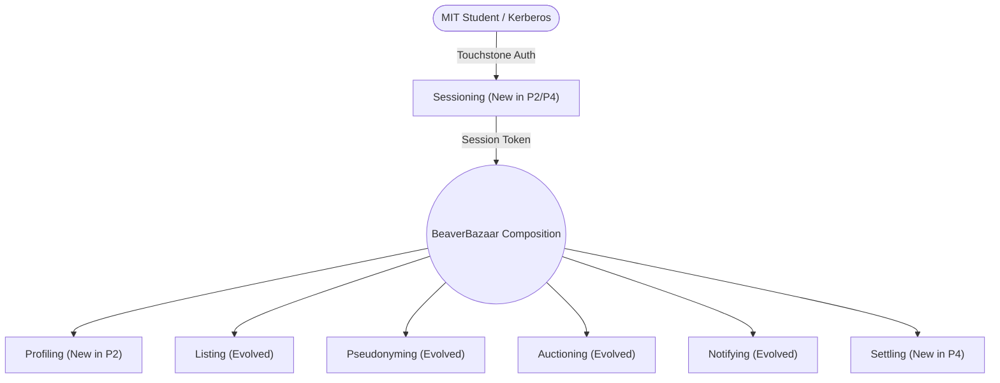

### A. Authentication & Access Control (`Sessioning`)
* **P1 Initial**: Omitted authentication; endpoints assumed a trusted `User` string, allowing trivial caller impersonation.
* **P2 (Alpha)**: Introduced `Sessioning[Subject]` with opaque tokens and preset test buttons (`Alice`, `Bob`) to facilitate development.
* **P4 (Final)**: Integrated production **MIT Touchstone OIDC via Petrock** (`petrock.mit.edu`) with RFC 6749 HTTP Basic token exchange, CSRF state verification, and 30-minute sliding expirations.

<p align="center">
  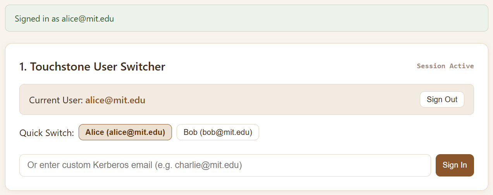
  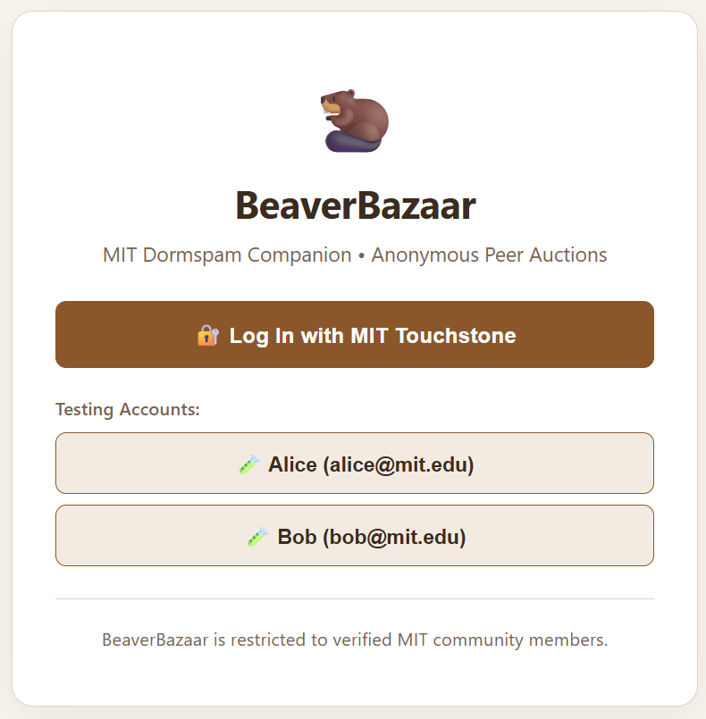
</p>

### B. Out-of-Band Contact Management (`Profiling`)
* **P1 Initial**: Conflated user identity with contact information; sellers would have had to post phone numbers directly on public listings.
* **P4 (Final)**: Decoupled into `Profiling[User]`. Names and phone numbers are stored strictly out-of-band, never appearing on public listings, and are revealed only to winning counterparties upon auction closure.

### C. Post-Auction Resolution: Decoupling `Settling` from `Notifying`
* **P1 / Early P4 Flaw**: Concluded transactions were delivered solely as plain text notification strings in `Notify`. When users dismissed notifications to clear their inbox, **the counterparty's contact details and final price were permanently deleted from the database**.
* **P4 (Final)**: Separated transient alerts from durable agreements:
  * **`Settling`**: Immutable, readonly log of concluded transactions (`/settlements/list`). Cannot be dismissed or altered.
  * **`Notifying`**: Ephemeral alert queue (`/notifications/list`). Users can freely dismiss alerts without losing settlement data. Also enabled real-time outbid notifications (`NotifyOutbidOnBid`).

<p align="center">
  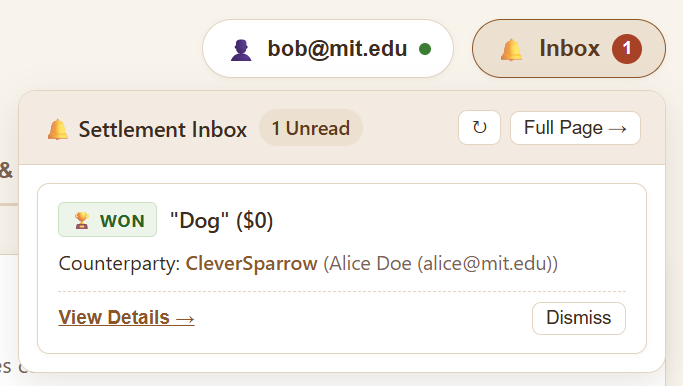
  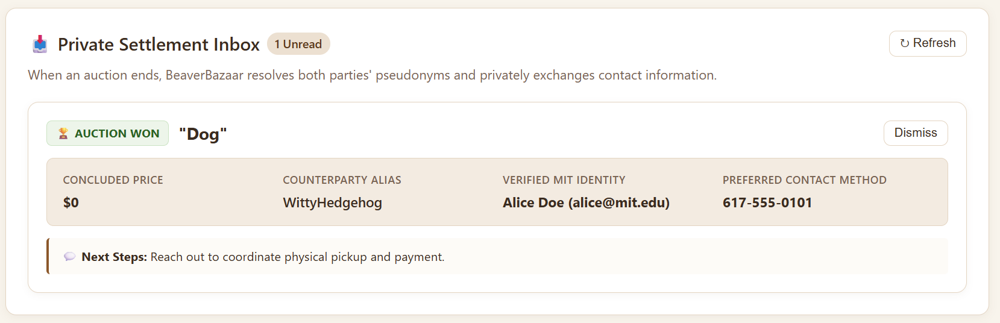
  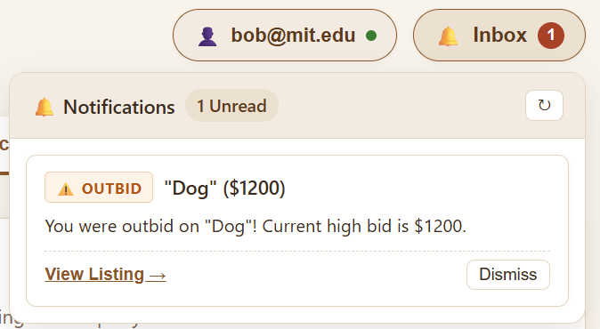
</p>

### D. Zero-Leakage Pseudonymity (`Pseudonyming` & Read Models)
* **P1 Initial**: Sketched contextual pseudonyms, but read endpoints leaked seller Kerberos IDs to help the frontend decide which buttons to render.
* **P4 (Final)**: Removed all real student identities from public read models (`MarketplaceFeed`, `ListingDetail`). The server evaluates `isUserSeller` and `isUserHighestBidder` relative to the session viewer, providing context-aware UI flags while transmitting **zero personal IDs over the network**.

<p align="center">
  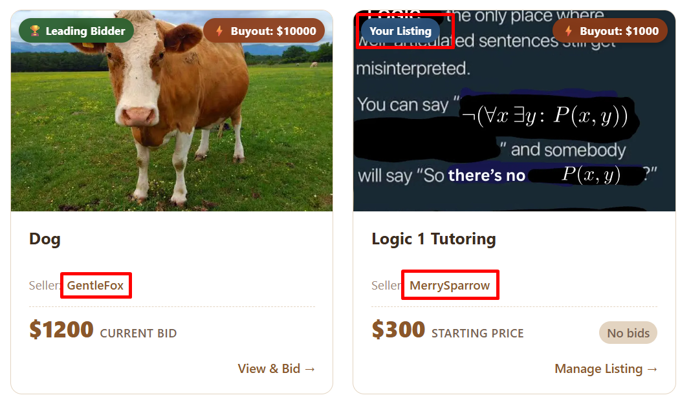
</p>

### E. Bidding Mechanics & Catalog Management (`Auctioning` & `Listing`)
* **`Auctioning`**: Bound `Owner` and `Bidder` strictly to `Alias`. Added concept-level anti-self-bidding (`OWNER_CANNOT_BID`), $0 giveaway support (`startPrice = 0`, `buyout = 0`), deletion guards (`CANNOT_DELETE_ACTIVE_BIDS`), and returning `outbid` on bids to trigger alert cascades.
* **`Listing`**: Expanded from an abstract token to rich media (`title`, `description`, `images seq of Image`) with strict length bounds ($\le 1000$ chars), safe raster/HTTPS URI sanitization, and client-side faceted filtering.

<p align="center">
  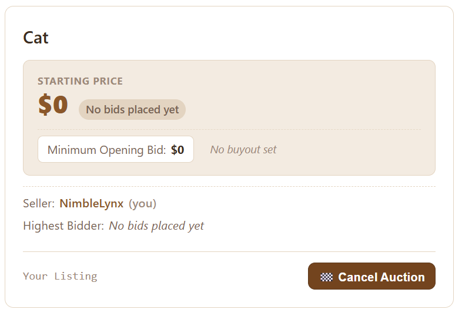
  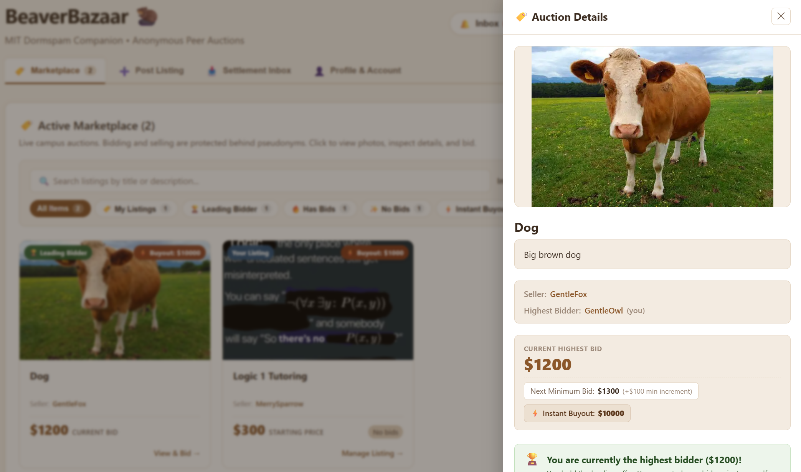
</p>

---

## 3. Visual & Interaction Design Evolution (P3 $\to$ P4)

Following user feedback in P3, interface clutter and information overload were systematically resolved:

* **Two-Tier Browsing (Listing Card vs. Listing Drawer)**: In P3, every listing card displayed full bidding controls, cluttering the feed. P4 introduced a skim-friendly card grid that opens a dedicated slide-out drawer (`ListingDetailDrawer`) upon selection, presenting high-res photos, description text, bid progression, and action controls.
* **Search & Faceted Scoping**: Added responsive, real-time client-side search across title/description scopes and status filters (`Mine`, `Winning`, `Has Bids`, `Unbid`, `Instant Buyout`).
* **Irreversible Action Safeguards**: Added explicit confirmation modals before placing bids, triggering instant buyouts, ending auctions, or deleting listings. On buyout, the listing drawer automatically closes and clears state.
* **Streamlined UI & Elevated Alerts**: Removed redundant login prompts across feature tabs, consolidated auth into `#/account`, and elevated `<StatusAlert />` with auto-scroll and dismiss controls.

<p align="center">
  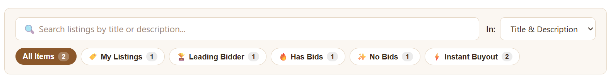
  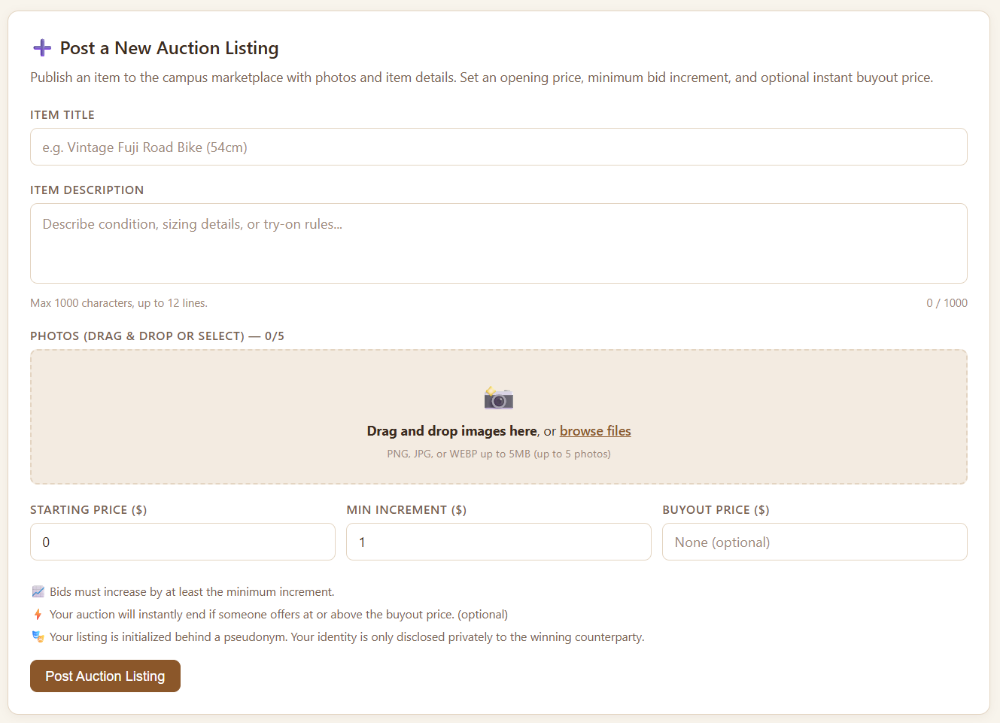
</p>

---

## 4. Reactions & Access Control Verification

Cross-concept synchronization is handled through six non-invasive sync-engine reactions:

```
[Client Mutation] ──► [Sessioning.current] ──► [Concept Action]
                                                      │
         ┌────────────────────────────────────────────┴────────────────────────────────────────────┐
         ▼ (Auction.bid)                                                                           ▼ (Auction.close)
 ┌───────────────┬───────────────┐                         ┌───────────────────────┬───────────────────────┬───────────────────────┐
 │ CloseOnBuyout │ NotifyOutbid  │                         │ SyncListingStatus     │ RecordSettlement      │ NotifyPartiesOnClose  │
 │ (Close if     │ (Alert if     │                         │ (Deactivate public    │ (Write permanent      │ (Dispatch closing     │
 │  bid>=buyout) │  bid displaced)│                        │  listing from feed)   │  receipt to Settling) │  settlement notices)  │
 └───────────────┴───────────────┘                         └───────────────────────┴───────────────────────┴───────────────────────┘
```

1. **`CloseOnBuyout`**: Automatically executes `Auction.close` when a bid reaches or exceeds the buyout price.
2. **`SyncAuctionListingStatus`**: Deactivates the public `Listing`, immediately withdrawing it from active feeds.
3. **`RecordSettlementOnClose`**: Resolves counterparties' registered profiles and commits an immutable record to `Settling`.
4. **`NotifySellerOnClose` & `NotifyBuyerOnClose`**: Dispatches private notices referencing the permanent Settlement Log.
5. **`NotifyOutbidOnBid`**: Detects displaced bidders on incremental bids and delivers an outbid notification with deep-links to the item drawer.
