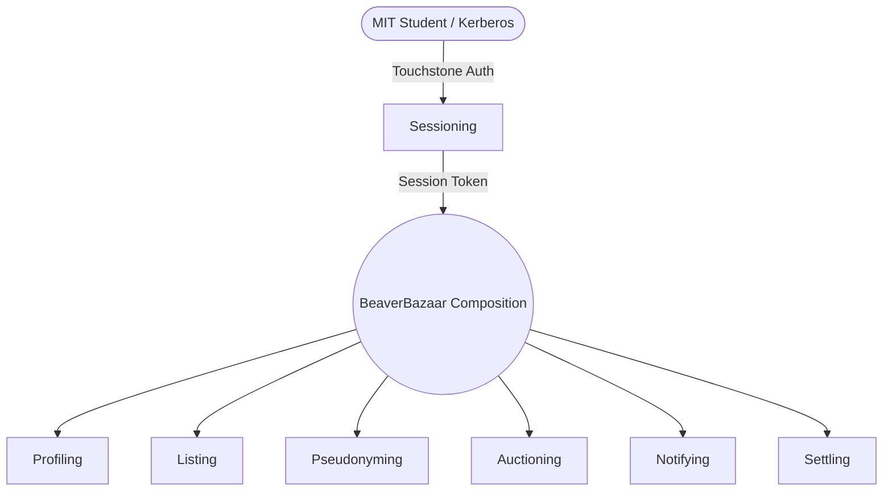

# BeaverBazaar — Software Design Document (P4)

**BeaverBazaar** is an anonymous peer-to-peer auction marketplace tailored for the MIT community, designed to replace chaotic dormspam email threads and spreadsheets with fair, synchronized, and privacy-preserving auctions.

- **Deployed Application**: [https://beaverbazaar.mit-sdg.dev](https://beaverbazaar.mit-sdg.dev) *(Local: `http://127.0.0.1:8080`)*
- **P3 Demo Video**: [P3 Beta Demo](https://youtu.be/PPSDaQ8sFDY)
- **P4 Demo Video**: [P4 Code-Complete Demo](https://youtu.be/siV2iYF6g9s)
- **Visual Design Study**: [Slide Presentation](https://docs.google.com/presentation/d/1lUvhIHo5sWtdN6N_uokCQdJ0MAK1Sp8GE7qkBk96m_0/edit?usp=sharing)
- **Authoritative Specifications**: [design/compositions/BeaverBazaar.md](design/compositions/BeaverBazaar.md) & [generated/beaverbazaar.md](generated/beaverbazaar.md)

---

## 1. System Architecture & Concept Independence

BeaverBazaar is structured following strict **Concept Design** principles using `@mit-sdg/sync-engine`. The domain is partitioned into seven self-contained, independent concepts that never directly reference or import each other:



### Core Concepts

| Concept | Purpose | State | Key Actions & Queries |
| :--- | :--- | :--- | :--- |
| **[Sessioning](design/concepts/Sessioning.md)** | Manage authenticated user sessions | `Sessions(session, subject, expiresAt)` | `start`, `current`, `end`, `_active` |
| **[Profiling](design/concepts/Profiling.md)** | Store private contact information out-of-band | `Profiles(user, name, contact)` | `update`, `_get` |
| **[Listing](design/concepts/Listing.md)** | Maintain public item listings and visibility | `Listings(owner, item, active)` | `create`, `update`, `deactivate`, `delete`, `_get` |
| **[Pseudonyming](design/concepts/Pseudonyming.md)** | Contextual, bijective alias generation | `Pseudonyms(context, user, alias)` | `getAlias`, `getUser` |
| **[Auctioning](design/concepts/Auctioning.md)** | Competitive incremental bidding and buyouts | `Auctions(owner, item, price, increment, active, buyout, highestBidder)` | `create`, `bid`, `close`, `delete`, `_get`, `_active`, `_byItem` |
| **[Notifying](design/concepts/Notifying.md)** | Asynchronous notification queue for users | `Notifications(user, message)` | `notify`, `dismiss`, `_all` |
| **[Settling](design/concepts/Settling.md)** | Record immutable, readonly bilateral settlements | `Settlements(buyer, seller, item, title, price, buyerAlias, sellerAlias, buyerName, buyerContact, sellerName, sellerContact, settledAt)` | `record`, `_forUser` |

---

## 2. Design Evolution: P1 to P4

The application has undergone several major architectural refinements from the initial P1 concept proposals and P3 visual designs:

### A. Separation of Transport Authentication from Identity (`Sessioning`)
* **P1 Initial Proposal**: Client requests passed raw `username` strings directly to application endpoints without verification.
* **P4 Implementation**: All mutating and private query endpoints require an opaque session token resolved against `Sessioning.current({ session })`. In production, sessions are issued exclusively after RFC 6749-compliant token exchange with MIT Touchstone via Petrock OIDC (`petrock.mit.edu`), guaranteeing that callers cannot act on behalf of another student.

### B. Out-of-Band Contact Management (`Profiling`)
* **P1 Initial Proposal**: Item listings included seller phone numbers directly in the listing description.
* **P4 Implementation**: Extracted private contact information into `Profiling`. Contact methods (e.g. phone numbers or pickup preferences) are strictly hidden during active bidding and are only disclosed to the winning counterparty upon successful auction resolution.

### C. Decoupling Auctioning from Real Identities (`Pseudonyming` & `Alias`)
* **P1 Initial Proposal**: `Auction` stored `owner: User` and `highestBidder: User`.
* **P4 Implementation**: `Auctioning` operates exclusively on opaque `Alias` types, never `User`. Bijective mappings between `User` and `Alias` are scoped to a specific `Listing` context via `Pseudonyming`. A bidder has different pseudonyms on different listings, preventing tracking of student interests or bidding habits across the marketplace.

### D. Automated Lifecycle Cascades (`Reactions`)
* **P1 Initial Proposal**: Manual coordination between bidding, listing deactivation, and notification.
* **P4 Implementation**: Automated via six sync-engine reactions that propagate state transitions without coupling concepts:
  1. `CloseOnBuyout`: Automatically ends an auction when a bid meets or exceeds the buyout threshold.
  2. `SyncAuctionListingStatus`: Deactivates the public `Listing` as soon as the `Auction` closes.
  3. `RecordSettlementOnClose`: Records an immutable bilateral `Settlement` between buyer and seller with final terms and registered contact methods.
  4. `NotifySellerOnClose`: Dispatches a notification to the seller informing them of the sale and referencing the Settlement Log.
  5. `NotifyBuyerOnClose`: Dispatches a notification to the winning buyer informing them of their win and referencing the Settlement Log.
  6. `NotifyOutbidOnBid`: Detects when a bidder is displaced on an incremental bid and dispatches an outbid notification with deep-linking to the listing drawer.

### E. Decoupling Settlements from Ephemeral Notifications (`Settling`)
* **P1/P3 Architecture**: Settlement details were stored exclusively inside notification strings. Dismissing a notification lost the counterparty's contact details permanently.
* **P4 Implementation**: Decoupled into a dedicated `Settling` concept that persists an append-only, readonly log of concluded transactions (`/settlements/list`). Notifications remain transient and dismissable without affecting settlement logs. Added deep-linking ("View Listing →") for outbid notices and confirmation prompts before irreversible actions (bids, buyouts, early finalizations, deletions).

---

## 3. Visual & Interaction Design Evolution (P3 to P4)

Following user feedback during the P3 milestone, several UX and interface improvements were completed:

```carousel

<!-- slide -->

<!-- slide -->

```

1. **Anti-Self-Bidding Protection**:
   The feed highlights items where the current viewer is the leading bidder, visually preventing accidental outbidding while still allowing an instant buyout option.
2. **Simplified Authentication & Session Management**:
   Removed confusing boilerplate notices from the auth landing page and consolidated Profile Settings and Account Switching into a single screen with prominent active Kerberos session indicators.
3. **Information Hierarchy in Inboxes**:
   Partitioned the quick notification drawer (concise badge tags) from the permanent Settlement Log (structured cards detailing item name, concluded price, counterparty alias, verified student identity, and offline payment instructions).
4. **Mobile-First Responsive Layout**:
   Refactored CSS grid declarations (`repeat(auto-fill, minmax(min(100%, 22rem), 1fr))`) and converted navigation tabs into swipeable bars on viewports $\le 640\text{px}$, preventing horizontal clipping on mobile devices.
5. **Confirmation Modals for Irreversible Actions**:
   Added confirmation dialog prompts before placing bids, instant buyouts, finalizing auctions, and deleting unbid listings to prevent accidental clicks. On instant buyout, the listing drawer cleanly closes.
6. **Marketplace Search & Scope Filtering**:
   Implemented client-side keyword search with title/description scoping and role/status filtering ('Mine', 'Winning', 'Has Bids', 'Unbid', 'Instant Buyout').

---

## 4. Reactions & Access Control Verification

All endpoints enforce strict authorization and access control policies:

```
[Incoming Request]
       │
       ▼
[Validate Sessioning.current] ──(Invalid/Expired)──► [HTTP 401 / Refusal]
       │
       ▼ (Valid User)
[Contextual Pseudonyming / Concept Validation]
       │
       ├──► Create Listing: Owner = User; Owner Alias = Pseudonym(Listing, User)
       ├──► Submit Bid: Bidder Alias = Pseudonym(Listing, User); Refuses if Owner == Bidder
       ├──► Close Auction: Refuses if Alias != Auction.owner
       ├──► Delete Auction: Refuses if Alias != Auction.owner OR highestBidder != null
       └──► Dismiss Notification: Caller verified against active session
```

* **Anti-Self-Bidding**: Enforced at the concept layer. In `Auctioning.bid`, `auction.owner == bidder` throws `OWNER_CANNOT_BID`. Because the seller's alias and bidder's alias are generated within the same `Listing` context, a seller bidding on their own item is immediately rejected.
* **Auction Ownership**: `/auctions/close` and `/auctions/delete` resolve the caller's session to their pseudonym for that listing. If it does not match `auction.owner`, the action is refused with `NOT_OWNER`.
* **Atomic Auction Deletion**: Deletion is only permitted on unbid auctions (`highestBidder == null`). Upon deletion, the endpoint atomically removes the associated listing record via `Listing.delete`.
* **Read-Model Privacy**: Public read models (`MarketplaceFeed` and `ListingDetail`) never leak `User` identities, emails, or phone numbers over the wire. Only contextual booleans (`isSeller`, `isHighestBidder`) are computed relative to the active session.

---

## 5. Test Suite & Quality Verification

BeaverBazaar maintains a comprehensive test suite with 65 passing tests across 11 test suites:

* **Concept Isolation Tests** (`tests/concepts/*.test.ts`): Verify operational principles, action partition domains, input boundary checks, reverse-chronological query ordering, and refusals for each of the 7 concepts (`Sessioning`, `Profiling`, `Listing`, `Pseudonyming`, `Auctioning`, `Notifying`, `Settling`) in complete isolation.
* **End-to-End Composition Tests** (`tests/compositions/BeaverBazaar.test.ts`): Verify full multi-user marketplace scenarios (Alice listing, Bob bidding, buyout reaction cascade, listing deactivation, permanent bilateral settlement dispatch, outbid notifications, and deletion access controls).
* **Security & Vulnerability Tests** (`tests/security/SecurityVulnerabilities.test.ts`): Verify protections against NoSQL injection attacks, price and bid bounds, string length constraints, and malicious image URI / XSS sanitization.
* **Marketplace Store & Filter Tests** (`tests/web/marketplaceStore.test.ts`): Verify client-side keyword search across title and description scopes, status filtering ('Mine', 'Winning', 'Buyout'), and listing constraints.
* **OIDC Integration Tests** (`tests/auth/PetrockOIDC.test.ts`): Verify RFC 6749 Basic auth encoding, authorization URL parameters, and claims parsing for MIT Touchstone.
