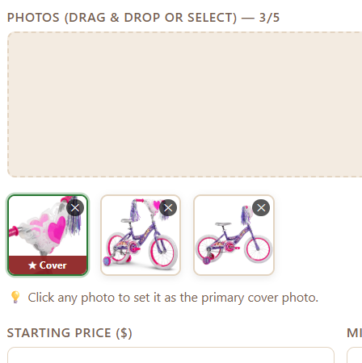
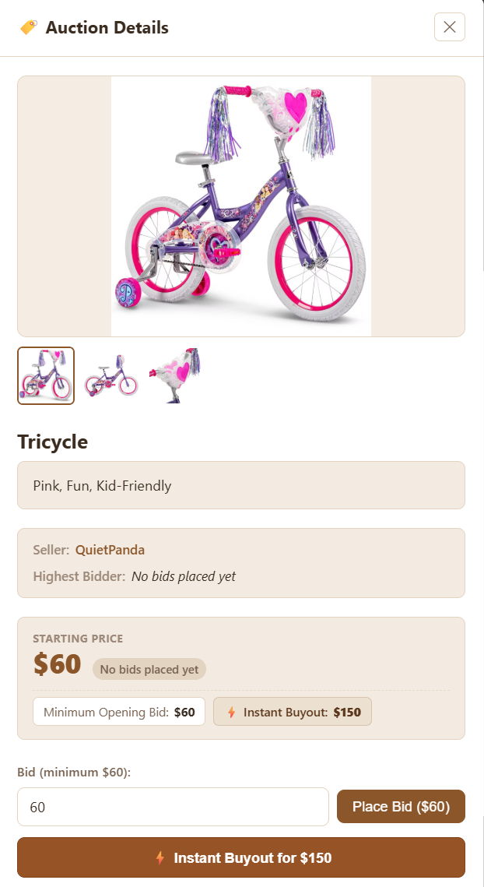

# Concept Design
In the initial proposal, four key concepts were laid out: `Listing[User, Item]`, `Auction[Owner, Item, Bidder]`, `Pseudonym[Context, User]`, and `Notify[User, Message]`. These largely described the overall composition of the application, but were missing many key concepts, which are key to functionality and user experience. Additionally these specifications unintentionally entangled different concepts, which became apparent during implementation. This section of the design document will describe the introduction and evolution of the concepts used in the application. Overall, we end up with the following concepts: `Listing[User, Image]`, `Auctioning[Alias, Listing]`, `Sessioning[User]`, `Profiling[User]`, `Pseudonyming[Context, User]`, `Notifying[User, Message]`, `Settling[User, Listing]`.

## Authentication & Access Control

### Before
- P1 intentionally omitted any notion of Sessioning
  - Was assumed to exist, producing the generic `User` type
  - Other concepts didn't care how `User` was created or represented
- P2 MVP simply used unverified login strings
  - Introduced a loose `Sessioning[User]` concept that was bound to a user ID
  - Allowed any user to login and thus impersonate one another
  - However, was useful as allowed focus on giving buyers/sellers different permissions, rather than mechanics of account management
  - Included presets for faster account-switching during development
- No expiry

### After
- P3 Beta introduced the proper integration of MIT Touchstone login through Petrock, a SIPB project
- Sessions automatically expire
- Endpoints now validate "private" requests through the secure session token, preventing impersonation
- Kept test accounts from the Alpha as enables hands-on testing without requiring someone else to constantly create/bid on listings

## Managing User Information

### Before
- Name and contact information of users were implictly stored in the `User` type
- Conflated user information with sessioning

### After
- Introduced a `Profiling[User]`
- Stores user information separately

## Resolving Listings

### Before
- `Notify[User, Message]` concept that conflated notifications with settlements
- Had separate views for settlements and notifications, but they were bijective and simply provided varying levels-of-detail
- Dismissing a notification of settlement also permanently erased the log of the settlement itself

## After
- Decoupled into `Notifying[User, Message]` and `Settling[User, Listing]` concepts
- Other notifications like when being outbid could be added
- Settlements now display a readonly log of settlements

## Maintaining Pseudoanonymity

### Before
- `Pseudonyming[Context, User]`
- Users are assigned a pseudonym unique to each listing they interact with

### After
- Fallback to a random UUID incase we run out of pseudonyms
- When users request all active listings, we attach fields that say whether or not they are the seller, highest bidder, etc.
- Permission to bid/manage listing is still verified server-side

## Listings & Auctions

### Before
- P1 intentionally left the concept `Listing[User, Item]` generic, as functionally it's not particularly important if the item has a name, description, images, etc.
- P2 MVP only gave listings titles, no other information
- Prevent listing owners from bidding on their own auction

### After
- Added images and descriptions
- Updated listing concept to `Listing[User, Image]`
- Updated auction concept to `Auction[Alias, Item]`
- Prevent highest bidder from re-bidding, but do allow buyout if available
- Searching and filtering feature

# Visual Design
Throughout the design process, the visual design has changed a lot. By the completion of P3, practically everything was finalized. However, P3 did not account for the introduction of various features, which has changed the design slightly.

### Creating Listings
The introduction of descriptions and images has greatly changed the layout of the creation page. The description field automatically scales in height to input, which makes reading easier. Additionally, users can easily click to select which image becomes the cover image, without having to reupload the images.

### Searching Listings
As previously discussed, the introduction of searching/filtering listings was not accounted for. The overall interface for this is extremely intuitive and responsive; it's client sided and doesn't require additional requests to the server. Of course, this does come with the tradeoff that the server must initially send ALL the listings on request, but since the app is small, it's not a big problem.
